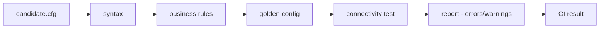

# network-ci-pipeline

**English** · [Português (Brasil)](README.md)

[](#) [](#) [](#.github/workflows/ci.yml) [](#)

## What it is

A **network-configuration validator for CI**: a pipeline that validates device configs (parsing, business rules, comparison against a "golden config" and a connectivity test) and produces a report of findings that either **block** (error) or just **warn**. It is meant to run as a single CI job (`netci validar`), applying a code-quality loop to network configs. An educational network-automation lab.

## Status

An educational lab, working and tested (183 tests).

## Features

- **Config parsing** of switch/router configuration (`parser.py`), with a syntax error stopping the stage.
- **Business rules** (`regras.py`): validates network-config best practices.
- **Golden-config comparison** (`golden.py`): differences against an approved reference.
- **Connectivity test** (`testes.py`): declared source/destination.
- **Report** (`relatorio.py`): findings (`error` blocks, `warning` does not).
- **CLI**: `validar` (one candidate) and `pipeline` (all candidates in a folder), with optional JSON output.

## Architecture

Five chained stages — **syntax → rules → golden → connectivity test → report**. The orchestrator (`pipeline.py`) stops at the first failing stage and builds the `Result` the report consumes. A syntax error halts; the rules still run if syntax fails (to report everything).



## Stack

- Python ≥ 3.10 (stdlib only), pytest (dev)
- CI: GitHub Actions (`ci.yml`, windows-latest, Python 3.11)

## Repository layout

```
network-ci-pipeline/
├── pyproject.toml · requirements.txt
├── src/netci/
│   ├── parser.py · sintaxe.py · regras.py · golden.py
│   ├── testes.py · pipeline.py · relatorio.py · achado.py
│   └── cli.py · __main__.py
├── dados/
│   ├── candidatos/      # candidate configs (ok, bad syntax/rules)
│   └── golden/           # reference config (switch-core.cfg)
├── docs/                 # what to block in CI, CI rules for networks
├── exemplos/relatorio-ci.md
├── tests/                # 183 tests
└── LICENSE               # MIT
```

## Prerequisites and installation

Python ≥ 3.10.

```bash
pip install -e .
```

## How to run

```bash
# validate one candidate
netci validar dados/candidatos/switch-ok-1.cfg --golden dados/golden/switch-core.cfg

# validate all candidates in a folder (CI mode)
netci pipeline dados/candidatos --golden dados/golden/switch-core.cfg --json resultado.json
```

## Tests and quality

Real command (verified by the agent):

```bash
python -m pytest tests/
# 183 passed
```

- CI (`ci.yml`, windows-latest, Python 3.11): checks encoding, imports the package and runs the suite.

## Technical decisions and trade-offs

- **`netci validar` as the single CI job command**: no wrapper; the exit code reflects the result.
- **Stop at the first failing stage**: fix the root cause (e.g. syntax) before noise in later stages.
- **Rules run even if syntax fails**: the report shows the full picture, not just the first error.
- **Distinct findings (error vs warning)**: errors block the merge; warnings document.

## Known limitations and roadmap

- Focused on syntax/rules/golden/connectivity for network configs; specific platform coverage is limited to the current parser.
- Connectivity is a declared source/destination test, not a real probe.

## Development process

An individual project by Kelvin Oliveira, built with orchestrated AI agents and reviewed by the author. The validation pipeline, the rules and the review are the author's.

## License and author

MIT — Copyright (c) 2026 Kelvin Rebelo de Oliveira.

**Author**: [Kelvin Oliveira](https://github.com/KelvinOliveiraCode) · [Portfolio](https://kelvinoliveiracode.github.io/portfolio/)
