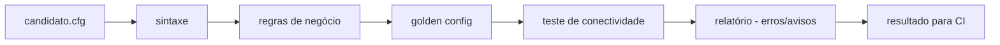

# network-ci-pipeline

[English](README.en.md) · **Português (Brasil)**

[](#) [](#) [](#.github/workflows/ci.yml) [](LICENSE)

## O que é

**Validador de configuração de rede para CI**: um pipeline que valida configs de equipamentos (parsing, regras de negócio, comparação com "golden config" e teste de conectividade) e gera um relatório com achados que **bloqueiam** (erro) ou apenas **avisam**. É pensado para rodar num job de CI (`netci validar`), inspirado no ciclo de qualidade de código aplicado a rede. Laboratório educacional de automação de rede.

## Status

Laboratório educacional funcional e testado (183 testes).

## Funcionalidades

- **Parsing** de configuração de switch/roteador (`parser.py`), com erro de sintaxe que encerra o estágio.
- **Regras de negócio** (`regras.py`): valida boas práticas de config de rede.
- **Comparação com golden config** (`golden.py`): diferenças contra uma referência aprovada.
- **Teste de conectividade** (`testes.py`): origem/destino declarados.
- **Relatório** (`relatorio.py`): achados (`erro` bloqueia, `aviso` não).
- **CLI**: `validar` (um candidato) e `pipeline` (todos os candidatos de uma pasta), com saída JSON opcional.

## Arquitetura

Cinco estágios encadeados — **sintaxe → regras → golden → teste de conectividade → relatório**. O orquestrador (`pipeline.py`) para no primeiro estágio que reprova e monta o Resultado que o relatório consome. Erro de sintaxe interrompe; as regras rodam mesmo se a sintaxe reprovar (para relatar tudo).



## Stack

- Python ≥ 3.10 (só stdlib), pytest (dev)
- CI: GitHub Actions (`ci.yml`, windows-latest, Python 3.11)

## Estrutura do repositório

```
network-ci-pipeline/
├── pyproject.toml · requirements.txt
├── src/netci/
│   ├── parser.py · sintaxe.py · regras.py · golden.py
│   ├── testes.py · pipeline.py · relatorio.py · achado.py
│   └── cli.py · __main__.py
├── dados/
│   ├── candidatos/      # configs candidatas (ok, ruins de sintaxe/regras)
│   └── golden/           # config de referência (switch-core.cfg)
├── docs/                 # o que bloquear em CI, regras de CI em rede
├── exemplos/relatorio-ci.md
├── tests/                # 183 testes
└── LICENSE               # MIT
```

## Pré-requisitos e instalação

Python ≥ 3.10.

```bash
pip install -e .
```

## Como executar

```bash
# valida um candidato
netci validar dados/candidatos/switch-ok-1.cfg --golden dados/golden/switch-core.cfg

# valida todos os candidatos de uma pasta (modo CI)
netci pipeline dados/candidatos --golden dados/golden/switch-core.cfg --json resultado.json
```

## Testes e qualidade

Comando real (verificado pelo agente):

```bash
python -m pytest tests/
# 183 passed
```

- CI (`ci.yml`, windows-latest, Python 3.11): confere encoding, importa o pacote e roda a suíte.

## Decisões técnicas e trade-offs

- **`netci validar` como único comando de um job de CI**: sem wrapper; o exit code reflete o resultado.
- **Parar no primeiro estágio que reprova**: corrige a causa raiz (ex.: sintaxe) antes de ruído em estágios seguintes.
- **Regras rodam mesmo se a sintaxe reprovar**: o relatório traz o quadro completo, não só o primeiro erro.
- **Achados distintos (erro × aviso)**: erro bloqueia merge; aviso documenta.

## Limitações conhecidas e roadmap

- Focado na sintaxe/regras/golden/teste de config de rede; cobertura de plataformas específicas é limitada ao parser atual.
- A conectividade é um teste declarado de origem/destino, não uma sondagem real.

## Processo de desenvolvimento

Projeto individual de Kelvin Oliveira, construído com agentes de IA orquestrados e revisado pelo autor. O pipeline de validação, as regras e a revisão são do autor.

## Licença e autor

MIT — Copyright (c) 2026 Kelvin Rebelo de Oliveira.

**Autor**: [Kelvin Oliveira](https://github.com/KelvinOliveiraCode) · [Portfólio](https://kelvinoliveiracode.github.io/portfolio/)
